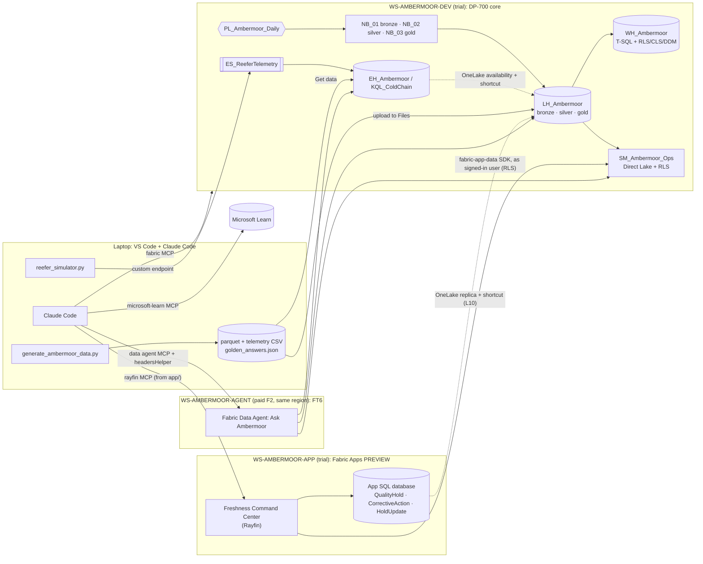

# Architecture: Ambermoor Fresh Ops POC

Two reference demos combined into one storyline:

- **Fabric App + Rayfin** (from "Build Your First Microsoft Fabric App with AI"): an app with an analytical read
  from a semantic model, transactional writeback, and RLS.
- **Fabric Data Agent** (from "From Data to Insights with Microsoft Fabric Data Agents"): natural language over a
  lakehouse, a semantic model and an eventhouse, tuned with instructions and few-shots.

Both sit on a DP-700-grade data platform and are built from one cockpit, Claude Code.

## Layers

| Layer              | Items                                                                                                                                       | Status                                          | DP-700 |
| ------------------ | ------------------------------------------------------------------------------------------------------------------------------------------- | ----------------------------------------------- | ------ |
| Ingest + medallion | LH_Ambermoor, NB_01–03, PL_Ambermoor_Daily, DF_Customer_Master                                                                             | GA (schema-enabled lakehouse:*verify* status) | D2     |
| Serving + security | WH_Ambermoor (RLS/CLS/DDM), OneLake security, SM_Ambermoor_Ops (RLS)                                                                        | OneLake security:*verify*                     | D1     |
| Real-time          | ES_ReeferTelemetry → EH_Ambermoor, KQL, shortcut, Activator                                                                                | GA,*verify* Activator                         | D2/D3  |
| CI/CD              | Git integration, deployment pipeline DEV→TEST                                                                                              | GA                                              | D1     |
| Ops                | Monitoring hub, Capacity Metrics, OPTIMIZE/V-Order                                                                                          | GA                                              | D3     |
| App                | Fabric App (Rayfin`dataapp` template): reads the model via `fabric-app-data` as the signed-in user; writeback holds via Rayfin entities | **Preview**                               | —     |
| Agent              | Ask Ambermoor: Claude Code +`fabric_query.py` on trial (FT5) → Fabric Data Agent + MCP on F2 (FT6)                                       | Data Agent:*verify* GA/Preview; needs paid F2 | —     |

## Design decisions (ADR-lite)

1. **Trial-first; F2 only for the agent.**
   - Every DP-700 lab and the Fabric App run on trial.
   - The Data Agent is the only hard paid dependency, isolated in its own workspace so the F2 can be paused.
2. **Separate workspaces for data, app and agent.**
   - Smaller blast radius.
   - Capacity isolation.
   - App/agent consumers never need Contributor+ on the data workspace, so RLS isn't bypassed.
3. **Two Claude Code cockpits.**
   - Repo root for platform work.
   - `app/` for Rayfin, because the `rayfin` MCP resolves packages from the Rayfin project root.
4. **Agent-as-code, runtime-agnostic.**
   - `agent/instructions.md` + few-shot JSON are the single source.
   - They are prototyped by Claude Code on trial (FT5) and imported into the Fabric Data Agent on F2 (FT6).
     Prompt work is never lost.
5. **Golden answers as the oracle.**
   - The planted storylines give exact expected values.
   - App KPIs, model measures and agent answers are all tested against the same JSON.
   - *Two-oracle reconciliation*: the deterministic DAX/SQL path and the natural-language agent path must agree.
6. **Delegated identity end to end for user data.**
   - The app's reads go through the `dataapp` template's `fabric-app-data` SDK, embedded in the Fabric portal as
     the signed-in user, so the model's RLS applies.
   - All app reads come from the model, including the `trace_genealogy` lot trace, so there is one security model.
   - The agent sits **next to** the app (decided 9 Oct). Calling it from Rayfin Functions would use the app
     identity and bypass per-user RLS. Revisit only with an on-behalf-of design.
7. **Single schema-enabled lakehouse for bronze/silver/gold.**
   - Simple for the POC.
   - For the client, weigh separate lakehouses per layer: item-level permission boundaries, separate
     deployment-pipeline rules.

## Open risks / to verify

- Can a data agent in `WS-AMBERMOOR-AGENT` (F2) use sources in `WS-AMBERMOOR-DEV` (trial)?
  - Keep both capacities in the **same region**. A third-party write-up reports cross-region sources fail.
  - If it still fails: (a) shortcut the DEV gold tables into a lakehouse in the agent workspace (Learn says agents
    can query shortcut-backed tables), or (b) temporarily move DEV to the F2 for the demo. F2 is small; expect
    throttling on Spark.
- Fabric Apps region availability for your trial capacity region (Learn: apps overview).
- Claude Code `.mcp.json` resolution when launched from `app/` inside the repo (see setup.md).
