# Fleet slice: trucks, live location and trip cost

Two client questions this answers:
- "Where is my truck right now, and is the load still cold?"
- "What does it cost to send a truck from A to B?"

All data is synthetic (seed 42). Coordinates are approximate state-level points. Cost rates are demo assumptions.

## 1. What changed (additive only)
The fleet columns come from their own RNG stream, so every column that existed before and golden answers Q1–Q8 are
byte-identical. Checked by diffing a pre-change run against a post-change run.

| Layer | Change | File |
|---|---|---|
| Generator | `dim_facility` + `latitude`, `longitude`; `dim_customer` + `latitude`, `longitude`, `route_km`; new `dim_truck` (48 trucks, cost rates); `fact_shipment` + `departed_ts`; `reefer_telemetry` + `latitude`, `longitude`, `speed_kmh`, `ignition_on` | `tools/generate_ambermoor_data.py` |
| Golden answers | **Q9** dock wait at P07, **Q10** trip cost | `agent/golden_answers.json` |
| Cross-check | DuckDB re-computes Q9/Q10 (14 checks, all PASS) | `tools/verify_golden.py` |
| Bronze | `dim_truck` added (19 files) | `fabric/notebooks/nb_01_load_bronze.py` |
| Gold | `dim_truck` pass-through; new **`fact_trip`** (one row per shipment); Q9/Q10 acceptance checks | `fabric/notebooks/nb_03_gold_fasttrack.py` |
| Eventhouse | Table gets 4 GPS columns (`.create-merge`); `TruckLatestPosition()` function; Activator query; GPS dock dwell; breadcrumb trail | `fabric/kql/coldchain.kql` (blocks 1, 7–11) |
| Dashboard | 7 tile queries for `RTD_Ambermoor_Fleet` | `fabric/kql/fleet_dashboard.kql` |
| Stream replay | Passes the GPS fields through | `tools/reefer_simulator.py` |
| Model | Proposed `fact_trip` / `dim_truck` relationships, 6 measures, validation queries E–F | `fabric/semantic-model/SM_Ambermoor_Ops.md` §6 |
| Agent | Source notes, rules 9–10 (dock wait, trip cost), 3 KQL + 3 T-SQL few-shots | `agent/instructions.md`, `agent/fewshots_*.json` |

**Storylines**
- **Q9 turns Q4's "what" into a "why".** P07's late Monday Foodservice deliveries (64.1% on time) are all caused at the
  dock: 14 of 14 waited more than 2 h before leaving (avg 6.26 h vs 0.52 h network). Drive time matched plan
  (13.1 h vs 13.57 h). Of the 158 late shipments elsewhere, 0 were dock-caused; those were late on the road.
  GPS shows the same thing: P07 has 15 shipments parked > 2 h at the dock, every other facility has 0.
- **Q10 cost from A to B.**
  - $3,957,156.99 over 3,317 trips.
  - Most expensive lane: P08→C0110, $87,543.17 (39 trips, 1,155 km).
  - Freight cost per case: P08 highest at $31.93, P06 lowest at $19.05.

## 2. Run order
Local, no capacity used:
```bash
python tools/generate_ambermoor_data.py --out data/generated --seed 42
python tools/verify_golden.py --data data/generated          # 14 × PASS
python tools/reefer_simulator.py --dry-run --limit 5          # events now carry latitude/longitude/speed_kmh/ignition_on
```
The notebooks were not run locally (no Java/PySpark on this machine). The `fact_trip` logic in NB_03 matches the
DuckDB check, but its first real run is in Fabric.

Fabric. Each step is a write, so it needs a one-line plan and Shekhar's OK. Target: `WS-AMBERMOOR-DEV`.
1. Re-upload the 19 parquet files to `LH_Ambermoor` → `Files/landing/ambermoor/`. Re-run `NB_01_load_bronze`, then
   `NB_03_gold_fasttrack`, and expect all acceptance checks PASS. **[D2]**
2. Eventhouse (this is FT2, still open):
   - Run block 1 of `coldchain.kql`.
   - Ingest `reefer_telemetry.csv`.
   - Run block 7 to create `TruckLatestPosition()`.
   - If the Eventstream already exists, check that its destination mapping includes the 4 new columns.
   **[D2]**
3. Create the Real-Time Dashboard (§3). **[D2]**
4. Activator rule (§3.3). **[D3]**
5. Semantic model §6 + Fleet report page. **[D1]**
6. Agent: re-run `/ask-ambermoor eval` for Q1–Q10.

**Timing:** `docs/phase-plan.md` reserves ~29 Oct – 2 Nov for exam revision with no new builds. Do steps 1–3 (~3 h)
before 28 Oct, or right after the exam if the client meeting falls later.

## 3. How it shows on a dashboard
Two paths, two tools. Interview keywords: **hot path** vs **cold path**.

```mermaid
flowchart LR
  SIM[reefer_simulator.py<br/>GPS + temp every 15 min] --> ES[Eventstream<br/>ES_ReeferTelemetry]
  ES --> EH[(Eventhouse<br/>ReeferTelemetry)]
  EH --> FN[TruckLatestPosition&#40;&#41;<br/>arg_max per truck]
  FN --> RTD[Real-Time Dashboard<br/>RTD_Ambermoor_Fleet]
  FN --> ACT[Activator<br/>warm load on moving truck]
  GEN[generator files] --> BR[bronze] --> GD[gold.fact_trip<br/>dock wait, drive, cost]
  GD --> SM[SM_Ambermoor_Ops<br/>Direct Lake] --> PBI[Power BI / Fabric App<br/>Fleet & freight page]
  EH -. OneLake availability .-> BR
```



### 3.1 Hot path: Real-Time Dashboard `RTD_Ambermoor_Fleet` (live; KQL)
The Real-Time Dashboard **Map** visual is listed among supported visuals on Learn with no Preview label (status per
Learn wording, Oct 2026).
- Click-path: workspace → **New item → Real-Time Dashboard** → add data source `KQL_ColdChain` → **Manage →
  Parameters**: `_truck` (single) and `_facility` (multiple, "Select all"). Then **Add tile** once per query in
  `fabric/kql/fleet_dashboard.kql`.
- Layout (1 page):

  | Row | Tiles |
  |---|---|
  | 1 | Multi stat: trucks / moving / stopped / warm loads (tile 2) · Alarms table (tile 3) |
  | 2 | **Map: latest position per truck**, label `truck_id`, coloured by `status` (tile 1). This is the money shot. |
  | 3 | Temperature line for `_truck` (tile 4) · Breadcrumb map for `_truck` (tile 5) |
  | 4 | Dock waits > 2 h by facility (tile 6, P07 sticks out) · Trucks moving per hour (tile 7) |
- Set auto-refresh, e.g. 30 s, while `reefer_simulator.py --truck TRK-117 --speed 120` replays a fault day. The
  TRK-117 dot turns "Warm load, moving" on the map. Check the minimum refresh interval your capacity allows.
- Optional: a **Fabric Maps** item with a layer from `TruckLatestPosition()` (Maps bind to stored functions; embedded
  queryset layers are deprecated). Facilities can be a lakehouse layer. Pin it to the dashboard: the pin / Fabric Maps
  tile is **Preview**; Fabric Maps itself is **status unverified**. Use it only if you want multi-layer styling. The
  built-in Map visual is enough for the demo.

### 3.2 Cold path: "Fleet & freight" page (history; DAX on Direct Lake)
Build it as a Power BI report page on `SM_Ambermoor_Ops` (after §6 of the model spec), or as a 4th page of the Fabric
App (`app/` cockpit, `rayfin-app` skill).
- KPI cards: Trip Cost, Freight Cost per Case, Avg Dock Wait (h), Dock-Delayed Late Trips.
- Bar: top 10 lanes by Trip Cost (Q10).
- Stacked bar per facility: Avg Dock Wait vs Avg Drive (h). Filter to Monday + Foodservice and P07's dock bar
  dominates (Q9).
- Table: trips for a selected lane with `departed_ts`, `dock_wait_h`, `drive_h`, `trip_cost_usd`.
- RLS: `fact_trip` relates to `dim_facility`, so a P03 QA manager only sees P03 trips.

### 3.3 Alert: Activator
On block 9 of `coldchain.kql`, open it in a KQL queryset → **Set alert** → run every 5 min → action Teams/email.
Activator stamps each event with the query run time, so the query returns current state only (Learn, "Ingestion from
KQL Querysets").

## 4. Bringing the two POCs together
Yes. They are two halves of one story:
- **Ambermoor** is the *what*: a Fabric platform with data, golden answers and business rules.
- **Agentic CI/CD** is the *how*: AI agents extend that platform through tickets, PRs, review and a human merge gate.

Put the agents to work on this repo instead of building a second, empty platform.

| Agentic CI/CD needs | Ambermoor already has | Add |
|---|---|---|
| A source system | Generator files in `Files/landing` | A telematics "daily export" source: CSV drop or the Azure SQL free offer (verify current terms) |
| Metadata-driven bronze framework | `NB_01` hard-coded `tables` list | Move the list to `fabric/metadata/sources.json` (name, path, format, PK). An onboarding ticket then edits a row, not code. |
| Agent onboarding / wiki | `CLAUDE.md`, `docs/data-model.md`, skills | `AGENTS.md` pointing to the same files (Codex reads AGENTS.md) |
| Tests the reviewer can trust | `verify_golden.py`, NB acceptance cells, golden Q1–Q10 | Run `generate` + `verify_golden` in the PR pipeline |
| Feature workspaces | `WS-AMBERMOOR-DEV` only | Fabric Git integration branch-out to a feature workspace; check GitHub vs Azure DevOps support and SPN auth on Learn |
| Review checklist | Data-contract and naming rules in `CLAUDE.md` | Checklist: contract updated, golden PASS, prefixes, no secrets, GA/Preview labels |
| Human merge gate | — | Branch policy: only Shekhar can complete the PR |

**The demo ticket that joins them:** "Onboard truck telematics history to bronze; key = truck_id."
1. The ticket has a planted mistake: the real key is `truck_id + ts`.
2. The developer agent branches out and adds the metadata row. Its DQ check finds duplicate `truck_id`s, so it stops
   and asks in the ticket instead of guessing. (This is the video's "agent catches my mistake" moment.)
3. After the human answers, the agent:
   - builds silver dedupe on `(truck_id, ts)`;
   - feeds GPS distance into `gold.fact_trip`;
   - updates `docs/data-model.md`;
   - shows `verify_golden.py` still PASSing Q1–Q10;
   - opens the PR.
4. The reviewer agent (other vendor) checks it against the checklist. The human merges. The deployment pipeline
   promotes DEV → TEST.
5. Result: the cold-path numbers (Q10) now come from data an agent onboarded. The hot path (live map) shows the same
   trucks. **One platform, two paths, one delivery method.**

Order of work: fleet slice first (it's demoable on its own and doesn't wait for approvals). Then the metadata file +
AGENTS.md (small). Then the agent loop, once the agentic POC is approved.

### 4.1 Decision (21 Oct 2026): one project, one business UI, a separate delivery track
**Shared (one of each):**
- **Platform**: lakehouse, Eventhouse, `SM_Ambermoor_Ops`, golden answers. The agents work on this platform, not on a
  copy of it.
- **Business UI**: the Fabric App gets a "Fleet & freight" page (cold path, DAX). `RTD_Ambermoor_Fleet` holds the live
  map (hot path, KQL). The app links to the dashboard. Embedding a Real-Time Dashboard inside a Fabric App is
  **status unverified**.
- **Repo and data contract**: agent tickets and PRs change this codebase. `verify_golden.py` is the merge gate's test.

**Separate (the agentic CI/CD track):**
- **Its UI is the delivery process**: board, ticket, PR, reviewer comments, merge. It gets no business dashboard of its
  own.
- **Approval and budget**: the agentic POC is approved on its own. The fleet slice doesn't wait for it.
- **Identity and blast radius**: the agents run as service principals and work only in feature workspaces branched
  from `WS-AMBERMOOR-DEV`. They never touch `WS-AMBERMOOR-APP`. Changes reach the app only through the deployment
  pipeline after a human merge.
- **Optional, later**: a "delivery metrics" page (ticket lead time, PRs per agent, review findings, agent spend), to
  make the business case. Not needed for the first demo.

**Why not two projects with two UIs:**
- The demo's key moment is "ticket → agent PR → merge → a new number in the *same* app the client already saw". Two
  UIs break that link.
- Two projects means two models, two sets of golden answers and two contracts that drift apart.
- It doubles CU on a shared trial capacity.
- It turns one client story into two unrelated demos.

**Meeting order:**
1. App and live map: the client's questions answered.
2. One trucking ticket through the agent loop: how Kion keeps extending it safely.

### 4.2 How tickets relate to trucking
A ticket is how a trucking question becomes a change to the data platform. The business asks a question, and the
ticket says what data or rule is missing to answer it. The agent's PR adds it. The reviewer and `verify_golden.py`
prove that nothing else broke. After the merge, the answer shows up in the app or the dashboard.

| Trucking question (business) | Ticket (what to build) | Agent's PR touches | Reviewer / test checks | Shows up in |
|---|---|---|---|---|
| "Why are P07 deliveries late?" | Add dock wait to trips | `fact_trip` (`dock_wait_h`), contract, golden Q9 | Q1–Q8 unchanged, Q9 PASS | Fleet page: dock vs drive bar |
| "What does a trip really cost?" | Onboard daily telematics history (planted wrong key) | metadata row, bronze/silver dedupe on `(truck_id, ts)`, GPS distance into `fact_trip` | DQ check on key, Q10 recomputed and explained | Fleet page: cost per lane / case |
| "Add fuel to trip cost" | New source: fuel card transactions per truck | new bronze table, `trip_cost_usd` formula, rule in `agent/instructions.md` | Contract + agent rule updated together, golden updated with reason | Cost KPI changes, with a note |
| "Tell me when a truck waits > 2 h at a customer" | Geofence + dwell alert | KQL function + Activator query in `coldchain.kql` | Query returns current state only, test on replay day | Activator alert, map status |
| "Which trucks need maintenance?" | Reefer health score per truck | KQL / gold aggregate from temperature drift | Excursion rule unchanged (Q2 still 4) | Dashboard tile |

Two kinds of ticket, don't mix them:
- **Change tickets** (above): build or extend the data product. These go through the agent → PR → merge loop.
- **Operational events**: TRK-117 has a warm load *now*. These are Activator alerts to dispatch or QA, not dev
  tickets. One can lead to the other: repeated false alarms → a change ticket "tune the excursion rule", which then
  needs QA sign-off because it changes a business rule.

## 5. Interview keywords (with this repo's example)
- **Latest-state pattern**: `summarize arg_max(ts, *) by truck_id` → one dot per truck on the map.
- **Hot path / cold path**: Eventhouse + Real-Time Dashboard for now; lakehouse gold + Direct Lake for trip cost.
- **Dwell time**: minutes from first ping to first `speed_kmh > 0`. P07 trucks sit 3.5–7 h.
- **Schema evolution, additive**: `.create-merge table` appends columns. A new RNG stream keeps old answers stable.
- **Golden answers as a CI oracle**: the reviewer agent trusts `verify_golden.py` PASS, not the author's claim.

## 6. Open points
- What the client's telematics actually sends (GPS + reefer temperature in one message, or two feeds), and how
  fresh it is. If it only exports daily files, the hot path is a demo of what's possible, not of their data.
- Fabric Git integration with a service principal on the trial capacity: test it before planning the agent loop.
