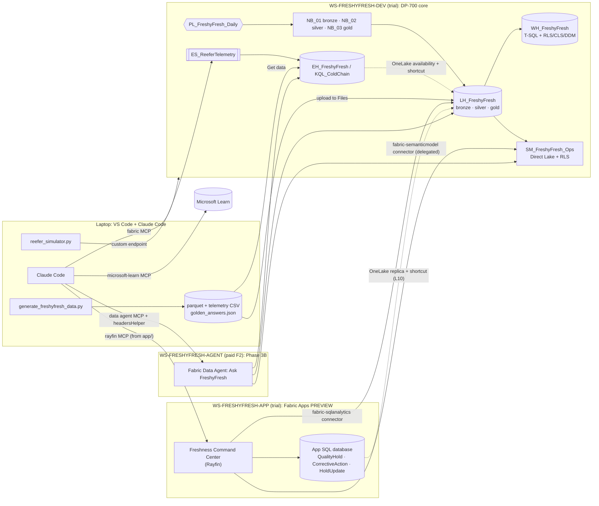

# FreshyFresh Ops POC: design record (9 Oct 2026)

The Claude Code starter kit `ambermoor-fabric-poc.zip` was delivered in chat on 9 Oct 2026. It combines the Fabric App/Rayfin demo and the Fabric Data Agent demo into one storyline for **FreshyFresh Foods**, a *fictional* refrigerated prepared-foods company. All data is synthetic, no real company is represented, and the build is sequenced DP-700 labs first.

## Re-sequenced 9 Oct (afternoon): App + agent first
- **Fast track this weekend (Sat 10 – Sun 11 Oct):** Fabric App + "Ask FreshyFresh" working end to end before DP-700 labs. Runbook: `docs/fast-track.md`; skill: `/fast-track`.
- **Agent, in two steps:**
  - FT5: Claude Code on trial via the read-only `tools/fabric_query.py` (ODBC + Entra token for the SQL endpoint; `azure-kusto-data` with az-cli auth for KQL).
  - FT6: a real Fabric Data Agent on a **pay-as-you-go F2 in the same region as the trial**. Shekhar has an Azure subscription in the same tenant.
- **Agent UX:** the agent sits **next to** the app, not inside it. This avoids app-identity calls that would bypass per-user RLS.
- **App read path:** the Rayfin `dataapp` template reads `SM_FreshyFresh_Ops` via Microsoft's `fabric-app-data` SDK, embedded in the Fabric portal as the signed-in user. The model's RLS applies.
  - The template ships with `services.data` disabled. Writeback (QualityHold / CorrectiveAction / HoldUpdate) needs it enabled with `dialect: mssql`.
- **Gold fast-track notebook:**
  - Precomputes `otif`, `is_excursion` and `tor_minutes` on `fact_shipment`.
  - Adds `ship_from_facility_id` to `fact_order_line`.
  - Builds the `trace_genealogy` mart (85,656 rows).
  - Tested end to end in local Spark: all acceptance checks PASS.
- **Remote Fabric query MCPs** (Data Warehouse, Eventhouse) are Preview and documented for VS Code/Copilot sign-in only, so they are optional, not on the critical path.

## Decisions taken with Shekhar
- Own tenant on **Fabric trial**.
- Claude Code with the **local Fabric MCP** already connected.
- **Fictional food & beverage company only**: no real client names in the kit.
- **DP-700 layers first**; Fabric App + agent after the exam.

## Verified constraints (re-check on Learn; Fabric changes monthly)
- **Fabric Data Agent** (and its MCP endpoint) needs **paid F2+ / P1+**. Trial is blocked (Learn prereq + community threads). The plan is a pay-as-you-go F2 only for `WS-FRESHYFRESH-AGENT`, paused when idle.
- **Fabric Apps (Rayfin) is Preview.**
  - It works on trial in supported regions and needs the tenant setting *Fabric Apps (preview)*.
  - Rayfin 1.36.2 can't add *new* KQL connectors.
  - The `fabric-semanticmodel` connector is delegated-only, so model RLS applies.
- **Rayfin's agent files vs Claude Code.**
  - Rayfin writes `AGENTS.md`, a `.mcp.json` entry (`mcpServers.rayfin` = `npx -y @microsoft/rayfin-mcp start`) and `.agents/skills/`.
  - Claude Code does **not** read `.agents/`.
  - With a CLAUDE.md present, Claude Code doesn't auto-load AGENTS.md, so `app/CLAUDE.md` starts with `@AGENTS.md`.
- **A published data agent is an MCP server.**
  - Endpoint: `https://api.fabric.microsoft.com/v1/mcp/workspaces/{ws}/dataagents/{id}/agent`.
  - It has no dynamic client registration.
  - The kit uses a Claude Code `headersHelper` that calls `az account get-access-token --resource https://api.fabric.microsoft.com`.
- **Microsoft Learn MCP:** `https://learn.microsoft.com/api/mcp` (public). It is in `.mcp.json` for verification.

## Golden answers (seed 42, window 2026-07-01..09-28)
| Q | Story | Expected |
|---|---|---|
| Q1 | Mock recall of onion lot ILOT-P02-ING02-20260908 | 36 lots, 145 cases shipped, 10 customers, 551 destroyed |
| Q2 | TRK-117 reefer fault | 4 excursion shipments (rule: ≥30 min cumulative > 5 °C); a naive query gives 112 |
| Q3 | Waste | P01 Cut Potatoes 5.42% in Aug vs median 0.54% |
| Q4 | On-time | P07 Monday Foodservice 64.1% vs 94.8% overall |

Cross-checked independently with DuckDB SQL: 9/9 PASS.

---

# Architecture: FreshyFresh Ops POC

Two reference demos combined into one storyline:
- **Fabric App + Rayfin** (from "Build Your First Microsoft Fabric App with AI"): an app with an analytical read
  from a semantic model, transactional writeback, and RLS.
- **Fabric Data Agent** (from "From Data to Insights with Microsoft Fabric Data Agents"): natural language over a
  lakehouse, a semantic model and an eventhouse, tuned with instructions and few-shots.

Both sit on a DP-700-grade data platform and are built from one cockpit, Claude Code.

## Layers
| Layer | Items | Status | DP-700 |
|---|---|---|---|
| Ingest + medallion | LH_FreshyFresh, NB_01–03, PL_FreshyFresh_Daily, DF_Customer_Master | GA (schema-enabled lakehouse: *verify* status) | D2 |
| Serving + security | WH_FreshyFresh (RLS/CLS/DDM), OneLake security, SM_FreshyFresh_Ops (RLS) | OneLake security: *verify* | D1 |
| Real-time | ES_ReeferTelemetry → EH_FreshyFresh, KQL, shortcut, Activator | GA, *verify* Activator | D2/D3 |
| CI/CD | Git integration, deployment pipeline DEV→TEST | GA | D1 |
| Ops | Monitoring hub, Capacity Metrics, OPTIMIZE/V-Order | GA | D3 |
| App | Fabric App (Rayfin): read model, writeback holds, RLS | **Preview** | — |
| Agent | Ask FreshyFresh: prototype in Claude Code (3A) → Fabric Data Agent + MCP (3B) | Data Agent: *verify* GA/Preview; needs paid F2 | — |

## Design decisions (ADR-lite)
1. **Trial-first; F2 only for the agent.**
   - Every DP-700 lab and the Fabric App run on trial.
   - The Data Agent is the only hard paid dependency, isolated in its own workspace so the F2 can be paused.
2. **Separate workspaces for data, app and agent.**
   - Smaller blast radius.
   - Capacity isolation.
   - App/agent consumers never need Contributor+ on the data workspace, so RLS isn't bypassed.
3. **Two Claude Code cockpits.**
   - Repo root for platform work.
   - `app/` for Rayfin, because the `rayfin` MCP resolves packages from the Rayfin project root.
4. **Agent-as-code, runtime-agnostic.**
   - `agent/instructions.md` + few-shot JSON are the single source.
   - They are prototyped by Claude Code on trial (3A) and imported into the Fabric Data Agent later (3B).
     Prompt work is never lost.
5. **Golden answers as the oracle.**
   - The planted storylines give exact expected values.
   - App KPIs, model measures and agent answers are all tested against the same JSON.
   - *Two-oracle reconciliation*: the deterministic DAX/SQL path and the natural-language agent path must agree.
6. **Delegated identity end to end for user data.**
   - The semantic-model connector is delegated-only, so the model's RLS applies.
   - The SQL connector is set to `delegated` (Rayfin defaults SQL connectors to `application`).
   - Don't call the data agent from Rayfin Functions with the app identity: that would answer as the app, not the
     user, and bypass per-user RLS. Open question for a later phase.
7. **Single schema-enabled lakehouse for bronze/silver/gold.**
   - Simple for the POC.
   - For the client, weigh separate lakehouses per layer: item-level permission boundaries, separate
     deployment-pipeline rules.

## Open risks / to verify
- Can a data agent in `WS-FRESHYFRESH-AGENT` (F2) use sources in `WS-FRESHYFRESH-DEV` (trial)?
  - If not, temporarily move DEV to the F2 for the demo. F2 is small; expect throttling on Spark.
- Fabric Apps region availability for your trial capacity region (Learn: apps overview).
- Claude Code `.mcp.json` resolution when launched from `app/` inside the repo (see setup.md).
